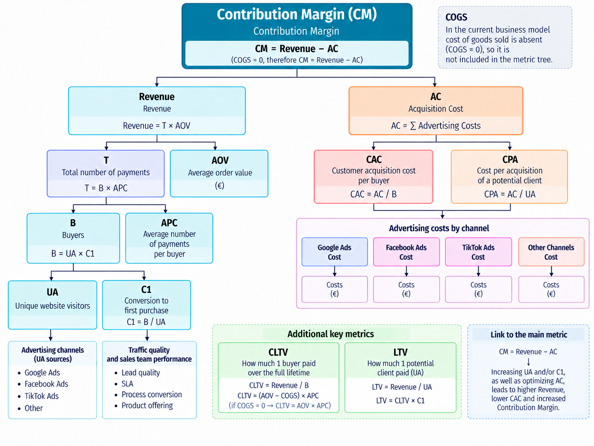
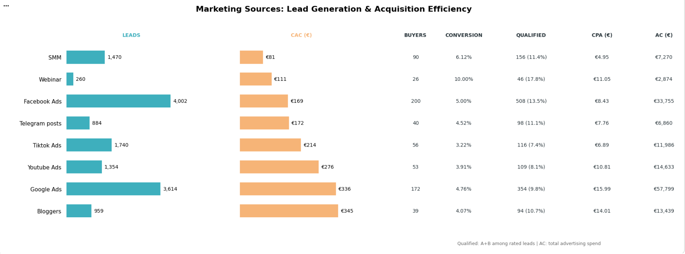
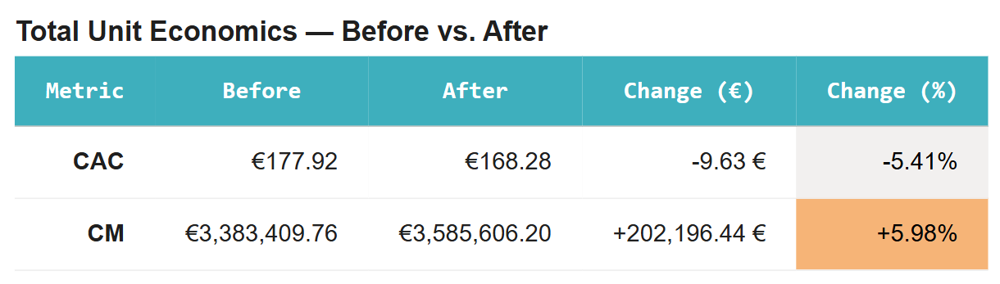
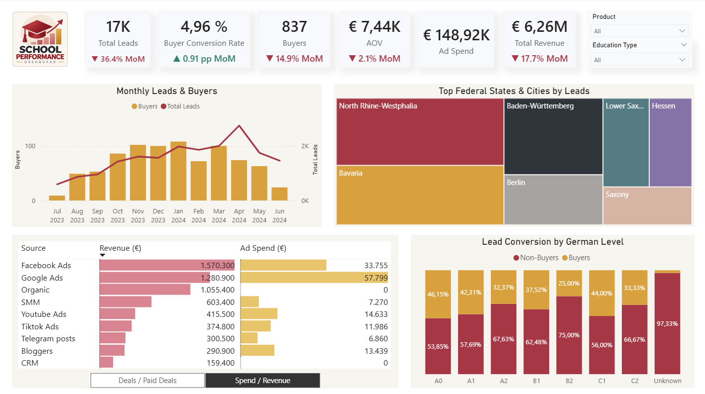
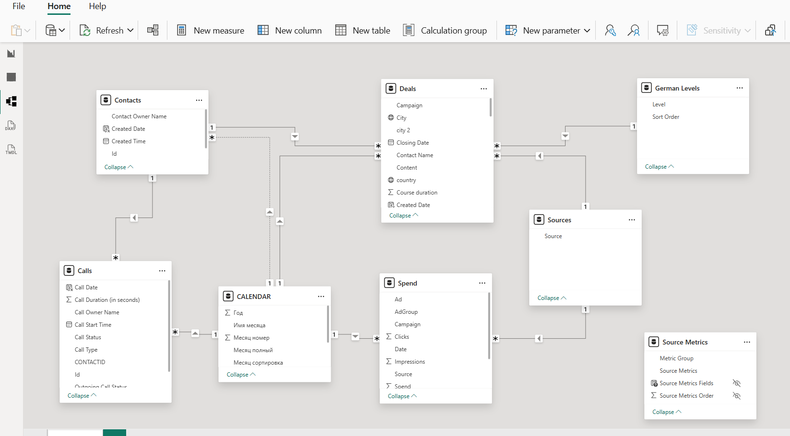

# Online Programming School | End-to-End Analytics & Business Growth Strategy

A comprehensive final Data Analytics project covering the entire analytical workflow using CRM, marketing, and financial data from an online programming school. The project combines multi-stage data processing and validation, in-depth exploratory and business analysis, statistical methods, marketing and sales performance analysis, product analytics, financial modeling, interactive Power BI dashboard development, and the formulation of a data-driven business growth strategy.

The work includes examining the structure of four original datasets; cleaning and transforming data; handling missing values and duplicates; standardizing values and data types; identifying anomalies; validating logical and financial consistency against business rules; engineering analytical features; and preparing related datasets for analysis and visualization. The prepared data was then used for a comprehensive analysis of time series, marketing campaigns, sales, conversion rates, lead quality, payment behavior, educational products, and customer segments. These findings supported Unit Economics calculations, metric tree development, growth opportunity identification, business hypothesis formulation, scenario forecasting, and A/B test design.

**Key Result:** Based on identified differences in marketing channel performance, a strategy was developed to optimize advertising budget allocation between Facebook Ads and Google Ads. Scenario modeling indicated the potential to reduce the overall Customer Acquisition Cost (CAC) by **5.41%** and increase Contribution Margin (CM) by **5.98%**, without increasing the total advertising budget.

A controlled A/B test methodology was designed to validate the proposed strategy.

*These changes represent a projected business impact, not results that have already been achieved.*

---

## Project Overview

This project is a **Final Capstone Project**, completed at the end of a comprehensive Data Analytics training program.

The project is based on the business case of an online programming school that uses a CRM system to manage prospective customers, phone interactions, sales, and marketing activities.

The school offered four main educational programs—Digital Marketing, Web Developer, UX/UI Design, and Data Analytics—as well as an additional offering, `Find yourself in IT`, designed to help prospective students choose a learning direction, and different study formats.

The project involved a comprehensive assessment of the current business situation, an evaluation of its core processes, the identification of weaknesses and potential growth opportunities, and an exploration of ways to improve business performance and financial results.

To address these objectives, a sequential analytical workflow was developed, comprising three Python notebooks, an interactive Power BI dashboard, and a presentation of the final business recommendations.

The project uses educational CRM data that simulates the operations of an online school.

---

## Project Objectives

The main objectives were to:

- Prepare CRM data for comprehensive analysis, ensuring data quality, consistency, and accuracy.
- Investigate lead generation trends, sales performance, and customer interactions.
- Evaluate the performance of marketing channels, advertising campaigns, and the sales department.
- Analyze conversion rates, lead quality, educational products, payment methods, and customer segments.
- Examine geographic differences and the relationship between German language proficiency and sales outcomes.
- Calculate Unit Economics for the business as a whole and for individual educational products.
- Identify a promising growth opportunity, formulate a business hypothesis, and estimate its potential economic impact.
- Develop a methodology for experimental hypothesis validation.
- Build an interactive dashboard and communicate the findings through clear, actionable business recommendations.

---

## Dataset Overview

The analysis was based on four original Excel datasets covering the school's CRM system and marketing activities.

| Dataset | Description |
|---|---|
| **Contacts** | Unique contact identifiers, responsible employees, and record creation and modification dates |
| **Calls** | Phone interaction history, call and contact identifiers, start times, durations, call types, statuses, and scheduling information |
| **Deals** | Deals, assigned sales managers, sales stages, lead quality, reasons for lost deals, marketing sources and campaigns, educational products, study formats, payments, SLA, cities, and German language proficiency levels |
| **Spend** | Marketing sources, campaigns, ad groups, individual ads, dates, impressions, clicks, and advertising spend |

The data enables analysis of the relationships between lead acquisition, interactions with the sales department, deal outcomes, and advertising campaign costs.

The tables are linked through contact identifiers, marketing sources, and advertising combinations.

During preliminary processing, the low-volume educational offerings `Data Analytics` and `Find yourself in IT` were excluded because there were too few observations for meaningful product-level comparisons. Subsequent product analytics focused on three main programs: Digital Marketing, Web Developer, and UX/UI Design.

---

## Project Workflow

The analytical workflow follows a clear sequence: preparing the source data, conducting a comprehensive business performance analysis, calculating Unit Economics, identifying a growth opportunity, and developing a strategy to improve business results.

### 1. Data Cleaning & Preprocessing

**Python Notebook 01 — Data Cleaning**

Comprehensive preparation of four source datasets was performed for subsequent analytical use.

**Main activities:**

- Initial inspection of data structure and descriptive statistics.
- Validation of data types, missing values, uniqueness, and duplicates.
- Conversion of dates, time fields, and numerical values.
- Cleaning and standardization of categorical variables.
- Removal of irrelevant, test, and technically incorrect records.
- Validation of chronological, logical, and financial consistency.
- Referential integrity checks across CRM tables.
- Creation and transformation of analytical features.
- Preparation of cleaned datasets for subsequent analysis.

Special attention was given to **business-rule-based validation**. For example, overlapping call times were checked to identify technical duplicates.

Missing values were not automatically replaced: decisions were made with consideration for CRM structure and the business meaning of the relevant fields.

**Result:** Four prepared datasets saved in Pickle format for further Python analysis, along with CSV exports for Power BI.

### 2. Exploratory Data Analysis & Business Performance Analysis

**Python Notebook 02 — Exploratory Data Analysis**

A comprehensive statistical, comparative, and business-oriented analysis of the online school's operations was conducted using the prepared datasets.

The analysis covered time-based trends, marketing efficiency, sales performance, sales department effectiveness, payment behavior, educational products, geographic distribution, and customer segments.

**Time Series Analysis**

- Analysis of trends in deal creation and closure.
- Daily, weekly, and monthly data aggregation.
- Investigation of relationships between call activity and sales outcomes.
- Calculation and interpretation of correlation coefficients.
- Analysis of deal closing times, distributions, and differences between successful and lost deals.

**Marketing Campaign Effectiveness**

- Analysis of lead generation, conversion, and advertising campaign performance.
- Comparison of marketing sources by lead volume and quality.
- Development of rules for counting unique leads using contact–product combinations.
- Handling of repeated deals and prevention of unjustified double counting.
- Attribution of leads to marketing sources and campaigns.
- Integration of marketing and CRM information to assess acquisition efficiency.
- Calculation and comparison of CAC, CPA, Conversion Rate, and related marketing KPIs.
- Analysis of lead generation trends and stability across advertising channels.

**Sales Department Performance**

- Evaluation of individual sales managers by deal volume, successful sales, conversion, and the value of closed sales.
- Comparison of advertising campaign performance.
- Investigation of how leads from different marketing sources were distributed among sales employees.
- Analysis of first-contact response times (SLA / Response Time).
- Assessment of the relationship between sales response time and deal success.
- Comparative analysis with consideration for the quality and composition of incoming leads.

**Payment & Product Analysis**

- Investigation of the distribution of payment types.
- Analysis of payment methods by deal stage and outcome.
- Assessment of payment data completeness and limitations affecting interpretation.
- Comparison of educational products by deal volume, conversion, and sales.
- Analysis of morning and evening study formats.
- Evaluation of differences in customer segment behavior and performance.

**Geographic & Customer Analysis**

- Additional cleaning and standardization of geographic values.
- Enrichment of CRM data with geographic attributes using a JSON reference file.
- Creation of city, federal state, country, and geographic coordinate features.
- Analysis of the geographic distribution of deals, buyers, and sales.
- Comparison of performance across cities and regions.
- Investigation of the relationship between German language proficiency and deal success.
- Geographic and customer segmentation using interactive maps, Bubble Charts, and Sankey Diagrams.

**Analytical Methods & Visualization**

Methods included grouping, aggregation, filtering, descriptive statistics, distribution analysis, correlation and comparative analysis, time series analysis, segmentation, KPI calculations, and interactive visualization.

Matplotlib, Seaborn, and Plotly were used to visualize the results.

The analysis included interpretation of identified patterns, assessment of data quality and completeness, formulation of findings, and discussion of methodological limitations.

**Result:** A comprehensive analytical report in Google Colab with calculations, visualizations, and business insights. After geographic data enrichment, the Deals table was also exported to CSV for Power BI.

### 3. Product Analytics & Unit Economics

**Python Notebook 03 — Product Analytics**

The online school's economic model was analyzed by calculating overall and product-level Unit Economics, investigating profitability drivers, and identifying potential areas for growth.

**Unit Economics**

A system of interrelated business metrics was developed and calculated:

- UA — Potential Clients.
- B — Buyers.
- T — Transactions.
- C1 — Conversion Rate.
- APC — Average Payments Count.
- AOV — Average Order Value.
- AC — Acquisition Costs.
- CAC — Customer Acquisition Cost.
- CPA — Cost per Potential Client.
- CLTV — Customer Lifetime Value.
- LTV — Value per Potential Client.
- Revenue — Estimated Revenue.
- COGS — Cost of Goods Sold.
- Gross Profit.
- CM — Contribution Margin.

Because the CRM did not contain a complete register of individual payment transactions, an estimation methodology was developed to calculate the number of payments and revenue using available payment terms, initial payments, course prices, and study duration.

In the model, **COGS was assumed to be zero** because separate cost-of-goods-sold data was not provided. This is a modeling assumption, not a claim that the school incurs no actual costs.

**Product-Level Unit Economics & Marketing Cost Allocation**

A multi-level attribution method was developed to allocate prospective customers and marketing costs to individual educational products.

The method includes:

- Identifying the product directly from CRM records when available.
- Recovering the product from verified product-specific landing pages.
- Using advertising combinations: Source → Campaign → Term → Content.
- Moving to broader levels of the advertising hierarchy when an exact match is unavailable.
- Keeping unattributed costs separate rather than allocating them without sufficient justification.
- Monitoring allocated and unallocated costs.
- Validating consistency between overall and product-level economics.

This method enabled the attribution of **99.80% of total advertising costs** to educational products, while keeping the remaining uncertain portion separate. The remaining costs were not allocated without sufficient justification.

The resulting allocations were used to calculate economic metrics for Digital Marketing, Web Developer, and UX/UI Design.

**Sensitivity Analysis & Metric Tree**

A sensitivity analysis was conducted to assess how changes in key economic metrics affect Contribution Margin.

A metric tree was developed to show relationships between business metrics and identify potential areas for improvement.



### 4. Growth Hypothesis & Scenario Modeling

The marketing analysis revealed an opportunity to improve customer acquisition efficiency by revisiting advertising budget allocation.

Facebook Ads and Google Ads generated comparable lead volumes but differed considerably in the number of buyers acquired and their acquisition costs.

**Marketing Channel Comparison**

| Metric | Facebook Ads | Google Ads |
|---|---:|---:|
| Leads | 4,002 | 3,614 |
| Buyers | 200 | 172 |
| Conversion Rate | 5.00% | 4.76% |
| CAC | €168.77 | €336.04 |

Facebook Ads generated slightly more leads, achieved a higher conversion rate, and acquired more buyers at a substantially lower acquisition cost.

**The key difference was CAC:** acquiring a paying customer through Google Ads cost almost twice as much.



**Business Hypothesis**

Based on these results, the following hypothesis was formulated:

*Reallocating part of the advertising budget from Google Ads to Facebook Ads could increase the number of paying customers and improve the school's economic performance without increasing total advertising spend.*

The proposed strategy changes how the combined budget of the two advertising channels is allocated:

| Marketing Channel | Before | Proposed |
|---|---:|---:|
| Facebook Ads | 37% | 55% |
| Google Ads | 63% | 45% |

The total budget remains unchanged. Spending on all other marketing channels also remains unchanged.

**To assess the potential economic effectiveness, scenario modeling was conducted while keeping historical channel efficiency metrics constant.**

**Scenario Modeling**

To evaluate the hypothesis, economic metrics were modeled before and after the proposed budget reallocation.

The model uses historical channel performance and assumes that each channel's CPA, CAC, and Conversion Rate remain constant as spending levels change.

**Projected Business Impact**

| Metric | Projected Change |
|---|---:|
| Additional Leads | +910 |
| Additional Buyers | +48 |
| Overall CAC | −5.41% |
| Contribution Margin | +5.98% |

According to the model, overall CAC could decrease from €177.92 to €168.28, while Contribution Margin could increase by approximately €202,196, without additional advertising expenditure.

These results demonstrate the potential economic impact of the proposed strategy. However, they are based on historical data and require experimental validation, as channel efficiency may change after reallocating the budget.



### 5. A/B Test Design

A controlled experiment was proposed to validate the business hypothesis by comparing the existing and new advertising budget allocation strategies.

**Experimental Design**

- **Control Group** — Existing advertising budget allocation.
- **Treatment Group** — Proposed budget reallocation.
- **Primary Metric** — Customer Acquisition Cost (CAC).
- **Randomization** — Randomly assigning the audience to independent, non-overlapping groups.
- **Experimental Conditions** — Simultaneous testing with equal budgets and comparable conditions, consistent attribution rules, and a fixed marketing attribution window.
- **Statistical Significance** — 5%.
- **Experiment Planning** — Defining sample size and experiment duration in advance, taking statistical power into account.

Statistical power, confidence intervals, sample size estimation, and conditions for determining experiment duration were also examined.

**Success Criterion:** A statistically significant reduction in CAC in the treatment group.

**The experiment was designed methodologically but was not actually conducted.**

---

## Power BI Dashboard

An interactive, single-page Power BI dashboard was developed to monitor the school's business metrics and conduct a comprehensive analysis of marketing channels, sales, time-based trends, regions, and customer segments.

### Main KPIs

- Total Leads.
- Buyer Conversion Rate.
- Buyers.
- Average Order Value (AOV).
- Advertising Spend.
- Total Revenue.

For five KPIs, **Month-over-Month (MoM)** comparisons were implemented. The calculations use the two latest complete months to avoid distortions caused by an incomplete final month in the dataset.

### Dashboard Analysis

**Monthly Leads & Buyers**

A dual-axis combination chart comparing monthly trends in prospective customers and paying customers.

**Top Federal States & Cities by Leads**

A hierarchical Treemap for geographic analysis, with Drill Down from federal states to cities.

**Marketing Source Performance**

An interactive matrix comparing marketing sources in two display modes:

- Deals / Paid Deals.
- Spend / Revenue.

Field Parameters are used to switch between the metric groups.

**Lead Conversion by German Level**

A 100% stacked column chart comparing Buyers and Non-Buyers across German proficiency levels A0–C2, including a separate Unknown category.

### Interactive Features

The dashboard includes:

- Slicers for Product and Education Type.
- Cross-Filtering among four analytical visualizations.
- Interactive selection of periods, marketing sources, regions, and language categories directly through the visuals.
- Drill Down for exploring the geographic hierarchy.
- Field Parameters for dynamically switching between metric groups.
- Custom Tooltips showing additional KPIs.
- Configured visual interactions and filtering exceptions.
- Month-over-Month calculations to track changes in key business metrics.

The Product and Education Type slicers affect three analytical visualizations but do not change the marketing source comparison matrix.

The four main visual components support interactive cross-filtering, allowing related metrics to be explored across different analytical dimensions.

All six KPI cards remain unchanged throughout these interactions.



### Data Model

A relational Power BI data model was created with eight tables, including the four original datasets and additional analytical tables.

The model includes a custom calendar table, supporting lookup tables, One-to-Many relationships, active and inactive relationships, custom DAX measures, and a parameter table for dynamic metric switching.

The calendar table was created using the date range of the project data and supports date-based analysis.



**Financial Metric Calculation Differences**

In Power BI, Total Revenue represents the full contractual value of successfully closed sales (*Booked Sales / Contract Value*), not necessarily payments already received.

Product Analytics uses a separate estimation model to calculate revenue received and the number of transactions based on available CRM data.

Therefore, financial metrics in Power BI and Unit Economics may differ because they use different calculation methodologies and represent different economic concepts. Such differences are not modeling errors.

**Business Value**

The dashboard provides centralized visibility into key KPIs, comparative marketing channel analysis, conversion and customer segment analysis, and identification of regional differences in an interactive format.

---

## Key Insights & Business Recommendations

**Marketing Efficiency**

A large volume of leads does not necessarily mean that an advertising channel is efficient. A comprehensive assessment must consider the number of buyers, conversion rates, lead quality, and acquisition costs.

Facebook Ads demonstrated a more favorable combination of these metrics than Google Ads, primarily because of its substantially lower CAC at a comparable lead generation volume, which provided the basis for developing the budget optimization hypothesis.

**Lead Quality & Conversion**

Marketing channels differ in the quality of the leads they attract and in sales outcomes.

Organic and Webinar show the highest observed conversion rates, while Facebook Ads and Google Ads generate the largest acquisition volumes.

Lead quality assessments must account for the subjective classifications made by sales employees.

**Sales Performance**

Differences in employee performance and relationships between sales department activity, lead response times, and deal success were identified. These results require consideration of differences in the quality and composition of incoming leads.

**Product & Customer Analysis**

Differences in deal volume, conversion rates, and sales performance were identified across educational products, study formats, cities, and customer segments.

Special attention was given to data completeness and limitations in interpreting metrics for categories with substantial missing data.

**Business Growth Opportunity**

Based on a comprehensive assessment of marketing efficiency and business economics, a potential growth opportunity was identified and an advertising budget optimization strategy was developed.

The proposed strategy was supported by a projected business impact assessment and a methodology for experimental hypothesis validation.

**Business Value**

The project demonstrates how systematic analysis of CRM, marketing, and financial data helps identify weaknesses in business processes, discover promising growth opportunities, estimate the potential impact of changes, and develop evidence-based recommendations for management decisions.

---

## Presentation & Business Communication

The project's key findings are presented in both German and English.

The materials cover the school's business metrics, marketing and sales analysis, identified growth opportunities, the proposed advertising budget optimization strategy, scenario modeling, and the methodology for validating the hypothesis.

Both presentations are accompanied by detailed presentation scripts explaining analytical metrics, findings, limitations, and business recommendations.

**Presentation Materials**

- [German Presentation](presentation/presentation_de.pptx)
- [English Presentation](presentation/presentation_en.pptx)
- [German Presentation Script](presentation/presentation_script_de.pdf)
- [English Presentation Script](presentation/presentation_script_en.pdf)

These materials demonstrate Data Storytelling, analytical presentation and visual communication skills, and the ability to explain complex analytical and economic findings in clear, accessible, professional language.

---

## Tools & Technologies

**Programming & Development Environment**

- Python.
- Google Colab.
- Pandas.
- NumPy.

**Data Cleaning, Processing & Validation**

- Data Inspection & Data Profiling.
- Data Cleaning & Preprocessing.
- Data Quality Assessment.
- Missing Data Analysis & Handling.
- Duplicate Detection & Removal.
- Data Type Conversion.
- Data Transformation & Standardization.
- Categorical Data Processing.
- Outlier & Anomaly Analysis.
- Data Validation & Consistency Checks.
- Business Rule Validation.
- Referential Integrity Checks.
- Feature Engineering.
- Data Integration & Aggregation.
- Data Export — CSV, Pickle, JSON Processing.

**Data Analysis & Statistics**

- Exploratory Data Analysis (EDA).
- Descriptive Statistics.
- Statistical Data Analysis.
- Distribution Analysis.
- Time Series Analysis.
- Temporal Aggregation.
- Correlation Analysis.
- Comparative Analysis.
- Segmentation Analysis.
- Conversion Rate Analysis.
- KPI Analysis.
- Sales Cycle Analysis.
- Geospatial Analysis.

**Data Visualization**

- Matplotlib.
- Seaborn.
- Plotly Express.
- Plotly Graph Objects.
- Interactive Data Visualization.
- Time Series Visualization.
- Heatmaps.
- Sankey Diagrams.
- Geographic Maps.
- Bubble Charts.
- Statistical & Comparative Charts.

**Business, Marketing & Sales Analytics**

- Business Performance Analysis.
- Marketing Analytics.
- Sales Analytics.
- Customer Analytics.
- Campaign Performance Analysis.
- Marketing Attribution.
- Lead Generation & Lead Quality Analysis.
- Customer Acquisition Cost (CAC).
- Cost per Acquisition (CPA).
- Conversion Funnel Analysis.
- Sales Manager Performance Analysis.
- SLA & Response Time Analysis.
- Product Performance Analysis.
- Payment Behavior Analysis.

**Product Analytics & Financial Modeling**

- Product Analytics.
- Unit Economics.
- Revenue Modeling.
- Customer Lifetime Value (CLTV).
- Contribution Margin Analysis.
- Marketing Cost Allocation.
- Hierarchical & Proportional Attribution.
- Product-Level Unit Economics.
- Sensitivity Analysis.
- Scenario Modeling.
- What-If Analysis.
- Metric Tree Development.
- Growth Opportunity Identification.
- Business Hypothesis Development.
- Business Strategy & Budget Optimization.

**A/B Testing & Experimentation**

- A/B Test Design.
- Experimental Design.
- Statistical Hypothesis Testing.
- Statistical Significance.
- Confidence Intervals.
- Statistical Power Analysis.
- Sample Size Estimation.
- Experiment Planning.
- SciPy Statistics.

**Business Intelligence & Power BI**

- Microsoft Power BI.
- Power Query.
- DAX.
- Relational Data Modeling.
- Data Relationships.
- Calculated Tables.
- Calendar Table.
- DAX Measures.
- Time Intelligence.
- Month-over-Month (MoM) Analysis.
- KPI Development.
- Interactive Dashboard Development.
- Field Parameters.
- Dynamic Metric Switching.
- Drill Down.
- Cross-Filtering.
- Interactive Slicers.
- Custom Tooltips.
- Visual Interactions.
- Dashboard Design & Business Reporting.

**Reporting & Communication**

- Microsoft PowerPoint.
- Analytical Reporting.
- Business Performance Reporting.
- Data Storytelling.
- Data Presentation.
- Business Recommendations.
- Data-Driven Decision Making.
- Business Communication.
- German & English Analytical Presentations.

---

## Project Structure

```text
online-school-end-to-end-analytics/
│
├── notebooks/
│   ├── 01_data_cleaning.ipynb
│   ├── 02_exploratory_data_analysis.ipynb
│   └── 03_product_analytics.ipynb
│
├── data/
│   ├── raw/
│   │   ├── Spend (Done).xlsx
│   │   ├── Contacts (Done).xlsx
│   │   ├── Calls (Done).xlsx
│   │   └── Deals (Done).xlsx
│   └── reference/
│       └── city_data_google_en.json
│
├── dashboard/
│   └── school_performance_dashboard.pbix
│
├── presentation/
│   ├── presentation_de.pptx
│   ├── presentation_en.pptx
│   ├── presentation_script_de.pdf
│   └── presentation_script_en.pdf
│
├── images/
│   ├── dashboard_overview.png
│   ├── data_model.png
│   ├── metric_tree.png
│   ├── marketing_acquisition_efficiency.png
│   └── scenario_modeling_impact.png
│
├── requirements.txt
└── README.md
```

The selected marketing analysis and scenario modeling visuals are stored in `images/`.

---

## How to Run the Project

The project was developed in Google Colab using original Excel datasets and files stored in Google Drive.

To reproduce the project independently:

1. Download the original Excel datasets and the supporting JSON reference file.
2. Install the required Python libraries listed in `requirements.txt`.
3. Update the import and export file paths in the notebooks to match your local directory structure or Google Drive folder.
4. Run `01_data_cleaning.ipynb` to prepare and export the cleaned datasets.
5. Run `02_exploratory_data_analysis.ipynb` for comprehensive statistical and business analysis, visualizations, geographic data enrichment, and export of `Deals.csv` for Power BI.
6. Run `03_product_analytics.ipynb` to calculate Unit Economics, perform scenario modeling, develop the business hypothesis, and design the A/B test.

The completed interactive Power BI dashboard is located in the `dashboard/` directory and can be opened in Microsoft Power BI Desktop.

*Note: The notebooks retain their original analytical logic and Google Colab file paths. Before rerunning them, adjust the data input and export paths for your own environment.*

---

## Author

Sabina Koniieva

**Data Analyst | Python | SQL | Power BI | Tableau**
